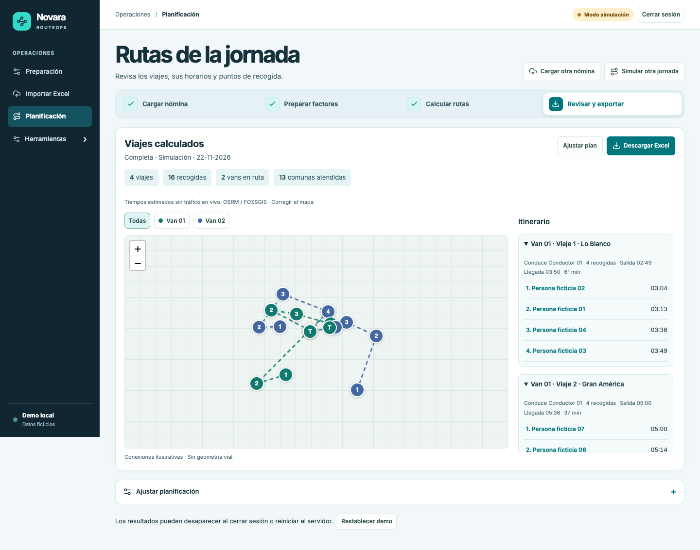

# Novara RouteOps

**Planificación supervisada de transporte de personal, con un experimento opcional en Amazon Bedrock para interpretar encabezados de Excel desconocidos.**

[English](README.md) · [Caso de portfolio](docs/portfolio.es.md) · [Arquitectura](docs/architecture.md) · [Evaluación de IA](docs/ai-headers.es.md)

RouteOps transforma nóminas Excel en vistas previas trazables: importa, conserva la procedencia, permite corregir ambigüedades, aprobar recogidas, preparar la flota, calcular rutas y exportar sus supuestos. Los ejemplos públicos contienen pasajeros ficticios y lugares públicos de referencia de Santiago de Chile.

## Estado actual

| Componente | Implementado |
| --- | --- |
| Ingesta | Perfiles deterministas, procedencia por celda, correcciones y revisión de duplicados |
| Interfaz | React: preparación, revisión, ubicaciones, flota, mapa y exportación Excel |
| Planificación conjunta | OR-Tools CP-SAT, flota compartida y hasta dos viajes de ingreso secuenciales por van |
| Reproducibilidad | Lockfiles Python/npm, pruebas automatizadas e imagen Docker verificada localmente |
| IA generativa | Adaptador opcional Bedrock Converse, propuestas validadas y evaluación; calidad del modelo real todavía sin medir |
| Nube | Plantilla preparada; despliegue público pendiente de habilitación del proyecto AWS |

**Los resultados son simulaciones para evaluación supervisada**, no instrucciones de despacho aprobadas. La demo alojada tiene clave, sesiones temporales aisladas y factores operativos fijos. Solo admite los archivos ficticios emitidos por esa misma sesión.

## Vista de la aplicación



Sesión sintética del perfil alojado: 16 solicitudes ficticias, 4 viajes y ninguna sin asignar en esta ejecución. El mapa es esquemático; no es un despacho operativo.

[Preparación en escritorio](docs/images/preparation-desktop.png) · [Preparación en móvil](docs/images/preparation-mobile.png)

## Flujo principal

Excel → ingesta determinista → revisión humana y procedencia → ubicaciones y matriz aprobadas → OR-Tools → mapa y Excel con supuestos.

El experimento de IA recibe únicamente encabezados sintéticos y propone correspondencias de columnas. No modifica registros, no aprueba datos y no calcula rutas. Consulta el [diagrama de arquitectura](docs/architecture.md).

## Ejecutar la aplicación sintética

Requisitos: Python 3.12 recomendado (mínimo 3.11), uv, Node.js 22 y npm. Desde la raíz:

```bash
uv sync --frozen
NOVARA_PRESET_DEMO=1 NOVARA_BROWSER_TEST_TOKEN=novara-synthetic-demo \
  uv run --frozen uvicorn scripts.frontend_demo:app \
  --host 127.0.0.1 --port 8001 --workers 1
```

En una segunda terminal:

```bash
cd frontend
npm ci
VITE_NOVARA_DEMO=1 NOVARA_DEV_API_PORT=8001 npm run dev -- --port 5174
```

Abre **http://localhost:5174** y pulsa **Probar con nómina incluida**. Reiniciar limpia la base en memoria. El fondo del mapa puede solicitar teselas externas. No se necesita invocar IA. Para la demo protegida en un solo contenedor, consulta [el procedimiento Docker](docs/deployment-render.md). Para configurar la operación local desde cero, consulta [la guía del operador](docs/frontend-v05.md).

## Verificar y evaluar

```bash
uv run --frozen ruff check .
uv run --frozen ruff format --check .
uv run --frozen pytest -q
npm --prefix frontend ci
npm --prefix frontend test
npm --prefix frontend run build
uv run --frozen python scripts/evaluate_headers.py --split test
python3 scripts/check_publication.py
```

La evaluación por defecto usa el vocabulario de los perfiles actuales y no realiza llamadas de red. Hay 36 casos escritos manualmente: 12 de desarrollo y 24 de prueba, con alias conocidos, ruido, expresiones nuevas, inglés, ambigüedad e inyección de instrucciones. [Protocolo y resultados](docs/ai-headers.es.md).

El SDK opcional se instala con `uv sync --frozen --extra ai`. Evaluar Bedrock requiere un modelo explícito, perfil AWS y `--allow-paid`. Solo se admiten modelos directos en `us-east-2`. La evaluación real está pendiente: las pruebas con respuestas simuladas verifican el contrato, no la calidad del modelo.

## Estructura

- `backend/app/`: FastAPI, ingesta, reglas, optimización, exportación e IA opcional.
- `backend/tests/`: pruebas unitarias y de integración con datos ficticios.
- `frontend/`: interfaz del operador y escenarios de navegador.
- `scripts/`: demos sintéticas, evaluación y control de publicación.
- `evals/headers/`: conjunto versionado y resultado base sin IA.
- `infra/aws/`: plantilla de infraestructura de la demo.
- `docs/`: caso de estudio, arquitectura, decisiones y guías.

## Límites

La planificación conjunta entrega vistas previas sin reserva persistente de despacho. El flujo antiguo `/services` conserva reglas de un viaje. Las matrices de referencia son estáticas y las conexiones del mapa son ilustrativas. SQLite requiere un proceso; varias instancias necesitan reservas transaccionales, migraciones y autenticación operativa. Los retornos y las transiciones de horario de verano siguen pendientes.

El acceso efectivo a un modelo Bedrock, sus métricas reales y la interfaz para aprobar correspondencias de IA deben validarse. Aún no se atribuye ninguna mejora de precisión al modelo. Los archivos privados, credenciales e historial de soporte AWS quedan fuera del repositorio público.

[Caso de estudio](docs/portfolio.es.md) · [Decisiones](docs/decisions.md) · [Roadmap actual](docs/roadmap.md) · [Preparación para GitHub](docs/publication.md)

Los workflows de GitHub Actions están preparados. Las pruebas locales no demuestran que CI remoto o el despliegue ya hayan terminado. Todavía no se ha elegido una licencia de código abierto.
