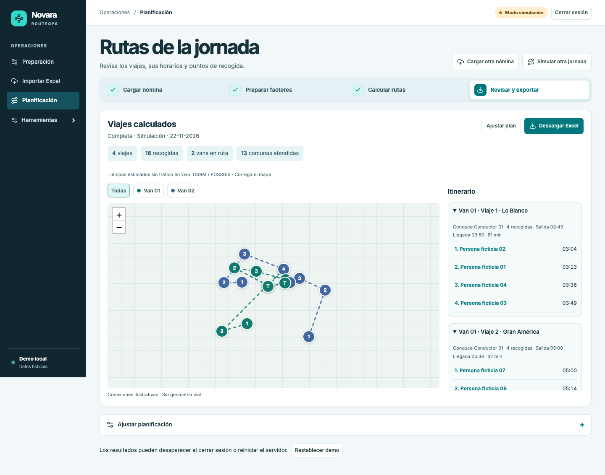
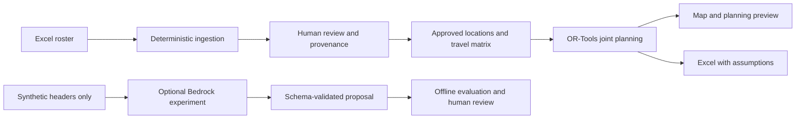

# Novara RouteOps

**Human-reviewed employee transport planning, with an optional Amazon Bedrock experiment for unfamiliar spreadsheet headers.**

[Español](README.es.md) · [Portfolio case study](docs/portfolio.md) · [Architecture](docs/architecture.md) · [AI evaluation](docs/ai-headers.md)

RouteOps turns Excel rosters into traceable planning previews: import, inspect ambiguous records, approve pickup locations, configure a shared fleet, calculate routes and export the result with its assumptions. The public examples contain fictitious passengers and reference public locations in Santiago, Chile.

## What works today

| Component | Current state |
| --- | --- |
| Data ingestion | Deterministic profiles, cell provenance, corrections and duplicate review |
| Operator application | React interface, preparation, location review, fleet, map and Excel export |
| Joint planning | OR-Tools CP-SAT, shared fleet, up to two sequential inbound trips per van |
| Reproducibility | Python and npm lockfiles, automated tests, Docker build verified locally |
| Generative AI | Optional Bedrock Converse adapter, strict proposals and offline evaluation harness; live model quality not measured |
| Cloud | Infrastructure template prepared; public deployment pending AWS project enablement |

**Planning previews are simulations for supervised evaluation.** They are not approved dispatch instructions. The hosted demo is a separate profile with a password, temporary isolated sessions and fixed operational factors. It accepts only the synthetic files issued by the same session.

## Application preview



Synthetic hosted session: 16 fictitious requests, 4 trips and no unassigned requests in this run. The map is schematic; this is not a live dispatch.

[Preparación en escritorio](docs/images/preparation-desktop.png) · [Preparación en móvil](docs/images/preparation-mobile.png)

## Architecture at a glance



The AI experiment has no write path into ingestion or dispatch. The optimizer consumes validated data and a travel matrix; the LLM does not generate routes.

## Run the synthetic application

Requirements: Python 3.12 recommended (minimum 3.11), uv, Node.js 22 and npm. Start from the repository root.

```bash
uv sync --frozen
NOVARA_PRESET_DEMO=1 NOVARA_BROWSER_TEST_TOKEN=novara-synthetic-demo \
  uv run --frozen uvicorn scripts.frontend_demo:app \
  --host 127.0.0.1 --port 8001 --workers 1
```

In a second terminal:

```bash
cd frontend
npm ci
VITE_NOVARA_DEMO=1 NOVARA_DEV_API_PORT=8001 npm run dev -- --port 5174
```

Open **http://localhost:5174** and choose **Probar con nómina incluida**. The database is in memory; restarting clears this demo. The map background may request external tiles. No model invocation is needed. For the protected single-origin container demo, see the [container runbook](docs/deployment-render.md). For a blank local API and operator setup, see the [operator guide](docs/frontend-v05.md).

## Verify and evaluate

```bash
uv run --frozen ruff check .
uv run --frozen ruff format --check .
uv run --frozen pytest -q
npm --prefix frontend ci
npm --prefix frontend test
npm --prefix frontend run build
uv run --frozen python scripts/evaluate_headers.py --split test
python3 scripts/check_publication.py
```

The default header evaluation uses the current profile vocabulary and makes **zero network calls**. The committed corpus has 36 hand-authored cases: 12 development cases and 24 test cases, covering known labels, noise, new expressions, English labels, ambiguity and prompt injection. [Protocol and results](docs/ai-headers.md).

To install the optional SDK, run `uv sync --frozen --extra ai`. Bedrock evaluation additionally requires an explicit model ID, AWS profile and `--allow-paid`. Only direct in-region models in `us-east-2` are accepted. Live evaluation is pending; mocked tests verify the integration contract, not model performance.

## Repository map

```text
backend/app/          FastAPI, ingestion, domain rules, planning, export and optional AI
backend/tests/        Synthetic unit and integration tests
frontend/             React operator interface and browser scenarios
scripts/              Synthetic demos, evaluation and publication checks
evals/headers/        Versioned header dataset and offline baseline report
infra/aws/            CloudFormation template for the hosted demo
docs/                 Case study, architecture, decisions and operating guides
```

## Engineering boundaries

- Joint planning is a preview, without its own persistent dispatch reservation. The legacy `/services` flow has separate single-trip semantics.
- Static reference matrices do not represent live traffic; map connections are illustrative.
- SQLite workflows require one process. Multi-instance production needs transactional reservations, migrations and an operational authentication design.
- Return journeys and daylight-saving transitions remain out of scope.
- Bedrock model access, paid-run metrics and the human approval interface for AI mappings remain to be validated. No AI quality improvement is claimed yet.
- Tests and examples use synthetic inputs. Private workbooks, local credentials and AWS support history are excluded from publication.

## Read the case study

[Problem, implementation, evidence and limitations](docs/portfolio.md) · [Architectural decisions](docs/decisions.md) · [Current roadmap](docs/roadmap.md) · [Publication checklist](docs/publication.md)

GitHub Actions workflows are included. A successful local test run is not a claim that remote CI or cloud deployment has already succeeded. No open-source license has been selected for this snapshot.
