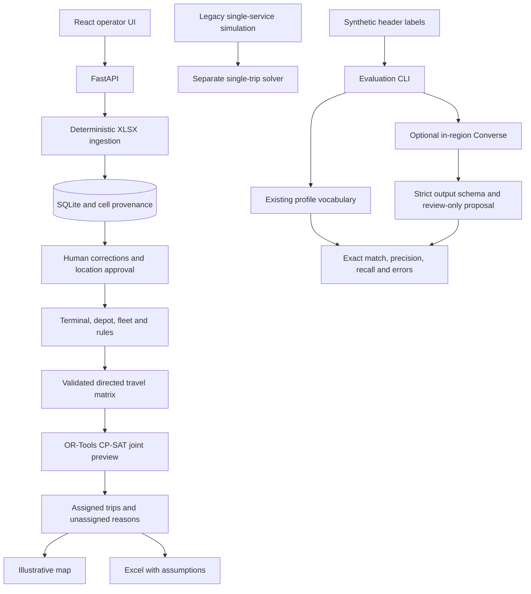

# Architecture / Arquitectura

[English overview](../README.md) · [Resumen en español](../README.es.md)

## Current application / Aplicación actual

The AI branch is a separate experiment, without a write edge into ingestion. La rama de IA es un experimento separado: no modifica la ingesta.

## Boundaries / Responsabilidades

- **Ingestion / Ingesta:** OpenPyXL reads without evaluating formulas. Size, sheet and row limits constrain uploads. Profiles recognize known headers, preserve cell evidence and separate unclassified records. Human corrections retain originals.
- **Preparation / Preparación:** the operator selects terminals, depot, fleet, approved pickups, matrix and constraints. Changes invalidate incompatible selections or previous results where implemented.
- **Joint planning / Planificación conjunta:** `/v3/plans/preview` uses CP-SAT for up to two sequential inbound trips per van. The result distinguishes complete, partial, infeasible and search-limit outcomes. It is not a persistent dispatch reservation.
- **Legacy / Flujo anterior:** `/services` retains its separate single-trip simulation and reservation behavior. Its restrictions must not be attributed to the joint preview.
- **Geospatial / Geoespacial:** provider contracts validate matrix dimensions, units and provenance. An operator-declared matrix is not independently certified by the application. Static demo data does not supply live traffic.
- **Export / Exportación:** Excel retains identifiers, dates, timing, unassigned requests and assumptions. User text is written safely rather than executed as spreadsheet formulas.
- **AI / IA:** `app.ai.headers` accepts at most 30 labels, each at most 120 characters. Rows are outside the input contract. A model response must match the field allowlist, unique column/field constraints and submitted index range. All proposals require human review. No tools are registered or executed.

## Execution / Ejecución

The local operator profile uses a configured SQLite database and operator token. The hosted synthetic profile serves compiled React and FastAPI from one origin, uses temporary per-browser databases and secure sessions, fixes operational factors and restricts uploads to session-generated examples. Run one worker. Session state disappears on restart; multi-instance operation requires another persistence and locking design.

El perfil local usa SQLite y token de operador. El perfil alojado sirve React y FastAPI desde un origen, con bases temporales por navegador, sesiones seguras y factores fijos. Se ejecuta con un worker. Reiniciar descarta las sesiones; varias instancias requieren otro diseño de persistencia y bloqueos.

## AI integration status / Estado de IA

The Bedrock adapter uses `bedrock-runtime.converse`, explicit output-token limits, bounded adaptive retries and timeouts. It permits only direct foundation-model IDs in `us-east-2`; inference-profile IDs and ARNs are rejected. Runtime errors, truncated output, tool-use blocks and schema failures produce explicit evaluation errors. Failed requests are not silently replaced by baseline results.

El adaptador fija región, límites y validaciones. La evaluación puede usar una línea base sin red o, con autorización explícita, Bedrock. La aplicación no carga este módulo automáticamente. Faltan la evaluación real del modelo y la interfaz para aceptar propuestas.
