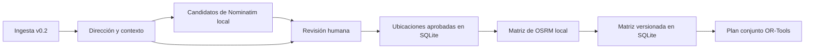

# Integración geoespacial v0.4

RouteOps conserva la dirección recibida, normaliza una copia para buscarla y presenta candidatos para revisión. El operador aprueba un candidato compatible o registra un punto manual con motivo. Las coordenadas aprobadas se usan para generar una matriz vial privada en SQLite. El planificador conjunto consume esa matriz mediante `matrix_id` y devuelve su procedencia junto con el plan.



## Proveedores y procedencia

| Contrato | Implementación | Tipo de resultado |
|---|---|---|
| `GeocodingProvider` | Nominatim autoalojado sobre OpenStreetMap y proveedor de candidatos ficticios para pruebas | Candidatos con indicador de coincidencia de comuna, ciudad y país |
| `TravelTimeProvider` y extensión `RoadMatrixProvider` | OSRM Table local y matriz sintética de prueba | Segundos y metros dirigidos. Se preserva la asimetría |
| `RouteGeometryProvider` | OSRM Route local con geometría GeoJSON | Coordenadas de la línea vial para una futura vista de mapa |

La normalización conserva la grafía original y homogeneiza espacios y mayúsculas en una copia. Comuna y ciudad se comparan sin tildes. Una dirección sin numeración o con indicios de intersección pasa a revisión. La selección de un candidato exige que coincida el contexto territorial reportado por el proveedor. Los puntos manuales y los candidatos se validan contra los rangos de coordenadas y la cobertura aproximada configurada para Santiago. La cobertura rectangular no comprueba el límite de una comuna ni la entrada exacta del domicilio. Incluso una coincidencia única requiere aprobación humana.

Una matriz **vial estática** contiene estimaciones de recorrido en una red cartográfica. El modo `synthetic` identifica simulaciones. El contrato de caché admite `time_dependent` con hora de salida para futuros proveedores. El solver exige una matriz estática y rechaza matrices temporales guardadas. El adaptador OSRM de esta fase no suministra tráfico histórico ni en tiempo real. [OSRM HTTP API](https://project-osrm.org/docs/v5.24.0/api/).

Los pares inaccesibles llevan `null` en duración y distancia. El solver excluye esos tramos en las recogidas, la llegada y el reposicionamiento. Una estructura incompleta, un par con solo uno de los valores o una respuesta sin punto conectado a la red se rechaza. OSRM entrega los valores fraccionarios, que se redondean hacia arriba a segundos y metros enteros para el solver. [OSRM HTTP API](https://project-osrm.org/docs/v5.24.0/api/).

## Configuración local desde VS Code

1. Abra el repositorio y seleccione `.venv/bin/python` como intérprete de Python. Ejecute `uv sync --frozen` en la terminal integrada.
2. Configure las variables de la tabla en el entorno de la terminal o en su configuración privada de ejecución. El arranque directo de Uvicorn toma las variables del entorno. Compose lee `.env` y las pasa al backend.
3. Ejecute `uv run --frozen uvicorn app.main:app --host 127.0.0.1 --port 8000 --workers 1`. En Swagger, `http://localhost:8000/docs`, use **Authorize** con el token. Para Compose, distinga la red accesible desde el contenedor de la red del host. El loopback del contenedor apunta al propio contenedor.

| Variable | Uso |
|---|---|
| `NOVARA_GEO_TOKEN` | Token privado de operador. Habilita la API geoespacial y exige Bearer para `/v2`, `/v3` y `/v4` |
| `NOVARA_GEO_LOCAL_AUTHORIZED=1` | Confirmación de que las instancias configuradas son locales y están autorizadas para procesar los datos |
| `NOVARA_NOMINATIM_URL` | Origen de la instancia local, por ejemplo `http://127.0.0.1:8080` |
| `NOVARA_OSRM_URL` | Origen de la instancia local, por ejemplo `http://127.0.0.1:5000` |
| `NOVARA_GEO_MAP_VERSION` | Identificador del extracto o compilación. Actualícelo si cambia cualquiera de los conjuntos cartográficos |
| `NOVARA_OSRM_PROFILE` | Perfil del grafo utilizado por OSRM, por defecto `driving` |

El token permite la aprobación manual aunque se dejen vacías las URLs. Los adaptadores HTTP aceptan solo IPs literales privadas RFC1918 o loopback, sin redirecciones ni proxies del entorno. Habilite únicamente instancias bajo control autorizado. Nominatim recibe dirección, comuna, ciudad y país. OSRM recibe coordenadas. Mantenga los registros de consultas desactivados o redactados también en esas instancias. [API de búsqueda de Nominatim](https://nominatim.org/release-docs/latest/api/Search/).

RouteOps está diseñado para un operador local. Mantenga el enlace a loopback, el token y el archivo SQLite bajo acceso privado. El token se configura fuera del repositorio. En ausencia de token, `/v4` queda deshabilitado y `/v2` y `/v3` conservan su modo local anterior para datos ficticios. La aplicación no añade servicios cartográficos a Compose ni descarga mapas. Los Excel y SQLite quedan fuera de la imagen Docker.

## Uso de la API

| Método y ruta | Resultado |
|---|---|
| `POST /v4/geo/addresses/validate` | Original, forma normalizada y motivos de revisión |
| `POST /v4/geo/requests/{id}/candidates` | Busca con la dirección y comuna de la solicitud. Permite aportar ciudad y reutiliza la caché |
| `GET /v4/geo/requests/{id}/location` | Estado, candidatos y procedencia de la aprobación vigente |
| `PUT /v4/geo/requests/{id}/location` | Aprueba mediante `candidate_id` o corrige mediante `point`. Requiere `reason` |
| `POST /v4/geo/matrices` | Genera o recupera una matriz con `request_ids` y `vehicle_origins`. Toma terminales y recogidas de las ubicaciones registradas |
| `GET /v4/geo/matrices/{id}` | Matriz dirigida, unidades, procedencia y fecha |
| `GET /v4/geo/matrices/{id}/metadata` | Procedencia y conteo de pares inaccesibles, sin las tablas |
| `POST /v3/plans/preview` | Usa `matrix_id` con los lotes, fecha, vans y orígenes del plan, sin volver a introducir `pickup_points` |

Al crear un plan con la matriz guardada, use el mismo conjunto de orígenes y las mismas coordenadas que al generar la matriz. Si se corrige una ubicación o cambia su aprobación, la vista previa devuelve un conflicto y requiere regenerar la matriz. La matriz anterior permanece consultable como evidencia. El contrato original de `/v3/plans/preview` para matrices aportadas por el operador sigue disponible. El plan conserva el límite global de dos viajes por van, la separación por cliente, el tiempo máximo a bordo, las ventanas y el reposicionamiento.

## Caché y reproducibilidad

La caché de geocodificación usa un identificador HMAC derivado de la dirección normalizada, el contexto, la instancia, el proveedor y la versión. La aprobación guarda coordenadas, estado, origen, motivo y fecha. Un cambio de dirección o comuna invalida el vínculo con la aprobación anterior. El token se usa como clave HMAC, por lo que rotarlo exige renovar las aprobaciones activas y regenerar las matrices que las usan.

Las matrices usan un identificador público opaco. Su clave de caché privada incluye instancia, versión, perfil, modo, unidades, hora de salida en UTC cuando corresponde, ubicaciones y revisiones de aprobación. Los metadatos muestran fecha de generación, versión configurada y versión de los datos de OSRM cuando el servidor la informa. La repetición de una solicitud con el mismo contexto recupera el mismo registro persistido. Cambie la versión configurada cuando reemplace el grafo o extracto. Las matrices históricas conservan su propia versión para reproducir un cálculo con los mismos puntos.

## Verificación de desarrollo

```bash
.venv/bin/python scripts/verify_historical_geo.py
.venv/bin/ruff check .
.venv/bin/ruff format --check .
.venv/bin/pytest -q
```

| Paquete archivado | Originales leídos | Solicitudes identificadas y pendientes | Simulación independiente |
|---|---:|---:|---|
| 1 de agosto, Gran América | 1 | 12, de las cuales 9 son acercamientos | 9 asignadas, 2 viajes, 2 vans |
| 3 de octubre, ambos clientes | 2 | 23, de las cuales 21 son acercamientos | 21 asignadas, 4 viajes, 3 vans |

La verificación abrió únicamente tres Excel originales de desarrollo en modo de lectura y comparó sus bytes antes y después. No se configuró un proveedor local autorizado para esa comprobación ni había coordenadas aprobadas para esos pasajeros. Los planes históricos quedan pendientes. Las simulaciones usan solo los conteos agregados por cliente y generan solicitudes, turnos, coordenadas y matriz ficticios. Las jornadas reservadas del 17 y 24 de octubre quedaron excluidas y la verificación no escribió datos reales a SQLite.

Las pruebas automatizadas ejecutan el contrato HTTP de los adaptadores con respuestas simuladas, la aprobación, la caché SQLite, los controles de acceso y la planificación conjunta. Para el dashboard v0.5 queda consumir la revisión de ubicaciones y las vistas previas desde una sesión autenticada y conectar la geometría vial a la visualización. La geometría ya tiene contrato y adaptador, y esa fase definirá cómo solicitarla y mostrarla con permisos de operador.
